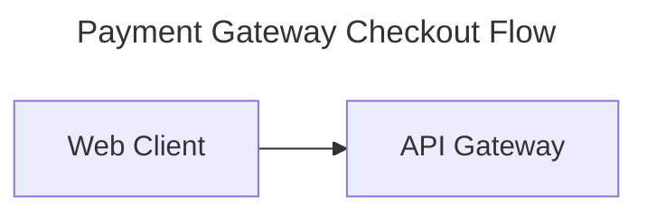

# Mermaid Diagram Engineering (`mermaid-diagram`)

Architect, style, audit, and export clear, syntactically valid, accessible **Mermaid.js (v11.x – v12.2+)** diagrams across all **32 official diagram types**.

Visual diagrams are the fastest way to communicate software architecture, data flows, state machines, and strategic models—but a single unquoted parenthesis, reserved keyword (`end`), mismatched port specifier, or unsupported beta tag can break rendering completely. This skill enforces a disciplined **6-Step Mermaid Engineering Flow**, a **3-Tier Renderer Compatibility System**, and a **100-Point Automated Quality Gate**.

---

## 1. The 6-Step Mermaid Engineering Flow

Follow this standardized workflow whenever creating, refactoring, debugging, or auditing Mermaid diagrams:

```text
┌────────────────────────────────────────────────────────────────────────┐
│                  THE 6-STEP MERMAID ENGINEERING FLOW                   │
├────────────────────────────────────────────────────────────────────────┤
│ 1. Intent & Tier Discovery  → Identify goal & host renderer tier (1–3) │
│ 2. Semantic Type Selection  → Pick optimal diagram from 32-type matrix │
│ 3. Layout, Look & Theme     → Configure YAML frontmatter (ELK/Neo/Base)│
│ 4. Defensive Syntax & Scope → Quote labels, escape chars, cap <=25 node│
│ 5. Accessibility Metadata   → Add title, accTitle, & accDescr tags     │
│ 6. Quality Audit & Export   → Run audit_mermaid.py (>=85/100) & export │
└────────────────────────────────────────────────────────────────────────┘
```

### Step 1: Intent & Target Renderer Tier Discovery

Before writing diagram code, determine where the diagram will be rendered and apply the matching compatibility tier:

| Tier | Target Host Environments | Supported Scope & Rules |
| :--- | :--- | :--- |
| **Tier 1 (`modern`)** | Mermaid v11.x–v12.2+, `@mermaid-js/mermaid-cli` (`mmdc`), Mermaid Live Editor, modern VitePress/Astro/Docusaurus | All **32 official diagram types**, `layout: elk`, `theme: redux-color`, `look: neo \| handDrawn`, `@ { shape: ... }` 30+ shapes, edge animations (`e1@{ animate: true }`), collapsible subgraphs (`@{ view: collapsed }`). |
| **Tier 2 (`github`)** | GitHub Markdown (`README.md`, PRs, Issues, Wiki), GitLab, Notion, Obsidian | Core + established v10/v11 types (`flowchart`, `sequenceDiagram`, `classDiagram`, `stateDiagram-v2`, `erDiagram`, `gantt`, `pie`, `gitGraph`, `C4*`, `mindmap`, `timeline`, `quadrantChart`, `sankey-beta`, `xychart-beta`, `block-beta`, `packet-beta`, `kanban`, `architecture-beta`). Avoid v12-only beta keywords (`agentflow-beta`, `swimlane-beta`, `usecase-beta`, `wardley-beta`, `cynefin-beta`)—use `flowchart` subgraph fallbacks instead. |
| **Tier 3 (`strict`)** | Constrained IDE/Agent artifact previewers & strict parsers | Restrict strictly to **6 core types**: `flowchart TD`/`LR`, `sequenceDiagram`, `stateDiagram-v2`, `classDiagram`, `erDiagram`, and `xychart-beta`. Always double-quote labels with punctuation (`id["Label (Info)"]`) and avoid HTML tags inside labels. |

---

### Step 2: Semantic Diagram Selection (All 32 Official Types)

Select the diagram type that matches the domain semantics rather than defaulting everything to a generic flowchart:

| Domain Category | Communicative Goal | Primary Keyword (v11/v12) | Tier 2/3 Fallback | Reference Guide |
| :--- | :--- | :--- | :--- | :--- |
| **Core Software & UML** | Workflows, decision trees, process routing | `flowchart TD` / `LR` | Native (Tier 1–3) | [core-software-and-uml-diagrams.md](references/core-software-and-uml-diagrams.md) |
| | Temporal request/response & actor lifelines | `sequenceDiagram` | Native (Tier 1–3) | [core-software-and-uml-diagrams.md](references/core-software-and-uml-diagrams.md) |
| | Code-like nested method call sequences | `zenuml` | `sequenceDiagram` | [core-software-and-uml-diagrams.md](references/core-software-and-uml-diagrams.md) |
| | OOP classes, interfaces, generics, packages | `classDiagram` | Native (Tier 1–3) | [core-software-and-uml-diagrams.md](references/core-software-and-uml-diagrams.md) |
| | Finite state machines, concurrency, choices | `stateDiagram-v2` | Native (Tier 1–3) | [core-software-and-uml-diagrams.md](references/core-software-and-uml-diagrams.md) |
| | Database schemas, keys (`PK`/`FK`/`UK`), crow's foot | `erDiagram` | Native (Tier 1–3) | [core-software-and-uml-diagrams.md](references/core-software-and-uml-diagrams.md) |
| | UML actors, system boundaries, `include`/`extend` | `usecase-beta` | `flowchart LR` | [core-software-and-uml-diagrams.md](references/core-software-and-uml-diagrams.md) |
| **Architecture, Cloud, Network & AI** | Multi-level software architecture (Context to Code) | `C4Context` / `C4Container` / `C4Component` / `C4Dynamic` / `C4Deployment` | `flowchart TB` with subgraphs | [architecture-cloud-and-network-diagrams.md](references/architecture-cloud-and-network-diagrams.md) |
| | Cloud/infra topology with service icons & port sides | `architecture-beta` | `flowchart LR` | [architecture-cloud-and-network-diagrams.md](references/architecture-cloud-and-network-diagrams.md) |
| | AI agent workflows, tool calls, prompts, failure paths | `agentflow-beta` | `flowchart TB` | [architecture-cloud-and-network-diagrams.md](references/architecture-cloud-and-network-diagrams.md) |
| | Explicit multi-column grid & hardware block layouts | `block` / `block-beta` | `flowchart TD` | [architecture-cloud-and-network-diagrams.md](references/architecture-cloud-and-network-diagrams.md) |
| | Network protocol headers & hardware bit registers | `packet` / `packet-beta` | Markdown table | [architecture-cloud-and-network-diagrams.md](references/architecture-cloud-and-network-diagrams.md) |
| **Data Charts & Analytics** | Bar & line plots over categorical/numeric axes | `xychart-beta` | Native (Tier 1–3) | [data-charts-and-analytics-diagrams.md](references/data-charts-and-analytics-diagrams.md) |
| | Multi-stage flow conservation & volume splits | `sankey-beta` | `flowchart LR` with edge weights | [data-charts-and-analytics-diagrams.md](references/data-charts-and-analytics-diagrams.md) |
| | 2x2 prioritization & positioning matrix (`[0..1, 0..1]`) | `quadrantChart` | Markdown table | [data-charts-and-analytics-diagrams.md](references/data-charts-and-analytics-diagrams.md) |
| | Multi-axis competency / spider comparisons | `radar-beta` | `xychart-beta` | [data-charts-and-analytics-diagrams.md](references/data-charts-and-analytics-diagrams.md) |
| | Hierarchical proportional area breakdown | `treemap-beta` | `mindmap` / `flowchart` | [data-charts-and-analytics-diagrams.md](references/data-charts-and-analytics-diagrams.md) |
| | Simple proportional part-to-whole slices / donut | `pie showData` | `xychart-beta` | [data-charts-and-analytics-diagrams.md](references/data-charts-and-analytics-diagrams.md) |
| | Set overlaps and logical intersections | `venn-beta` | `flowchart` subgraphs | [data-charts-and-analytics-diagrams.md](references/data-charts-and-analytics-diagrams.md) |
| **Project, Workflow & Strategy** | Project schedules, dependencies, critical paths | `gantt` | `flowchart LR` | [project-workflow-and-strategy-diagrams.md](references/project-workflow-and-strategy-diagrams.md) |
| | Cross-team / cross-actor process lanes | `swimlane-beta` | `flowchart LR` with subgraphs | [project-workflow-and-strategy-diagrams.md](references/project-workflow-and-strategy-diagrams.md) |
| | Sprint task boards with ticket/priority metadata | `kanban` | Markdown table | [project-workflow-and-strategy-diagrams.md](references/project-workflow-and-strategy-diagrams.md) |
| | Chronological milestones & historical eras | `timeline` | `flowchart LR` | [project-workflow-and-strategy-diagrams.md](references/project-workflow-and-strategy-diagrams.md) |
| | Git branching, merging, cherry-picking strategies | `gitGraph` | `flowchart LR` | [project-workflow-and-strategy-diagrams.md](references/project-workflow-and-strategy-diagrams.md) |
| | Radial brainstorming & knowledge hierarchies | `mindmap` | `flowchart LR` | [project-workflow-and-strategy-diagrams.md](references/project-workflow-and-strategy-diagrams.md) |
| | File/directory trees with icons & descriptions | `treeView-beta` | Annotated ASCII tree | [project-workflow-and-strategy-diagrams.md](references/project-workflow-and-strategy-diagrams.md) |
| | Customer experience steps & satisfaction scores (`1..5`) | `journey` | `sequenceDiagram` | [project-workflow-and-strategy-diagrams.md](references/project-workflow-and-strategy-diagrams.md) |
| | SysML v1.6 requirement traceability & verification | `requirementDiagram` | `classDiagram` | [project-workflow-and-strategy-diagrams.md](references/project-workflow-and-strategy-diagrams.md) |
| | CQRS / Event-Driven UI-Command-Event-ReadModel | `eventmodeling` | `sequenceDiagram` | [project-workflow-and-strategy-diagrams.md](references/project-workflow-and-strategy-diagrams.md) |
| | Value chain visibility vs evolution strategy | `wardley-beta` | `quadrantChart` | [project-workflow-and-strategy-diagrams.md](references/project-workflow-and-strategy-diagrams.md) |
| | Sense-making domains (Clear/Complicated/Complex/Chaotic) | `cynefin-beta` | `quadrantChart` | [project-workflow-and-strategy-diagrams.md](references/project-workflow-and-strategy-diagrams.md) |
| | Root-cause fishbone analysis | `ishikawa-beta` | `mindmap` / `flowchart RL` | [project-workflow-and-strategy-diagrams.md](references/project-workflow-and-strategy-diagrams.md) |

---

### Step 3: Layout, Look & Theme Architecture

Use **YAML Frontmatter** (`--- ... ---`) at the top of the diagram instead of deprecated `%%{init: ...}%%` directives (unless targeting a legacy parser that strips YAML headers):

```yaml
---
title: Order Processing Architecture
config:
  look: neo
  layout: elk
  theme: redux-color
---
```

- **v12.0+ Defaults**: `flowchart`, `sequenceDiagram`, `classDiagram`, `stateDiagram-v2`, `erDiagram`, `requirementDiagram`, `swimlane-beta`, `usecase-beta`, `agentflow-beta`, and `venn-beta` default to `theme: redux-color` and `look: neo` (and `layout: elk` for graph-based types).
- **Restoring Classic Look**: Set `theme: default`, `look: classic`, and `layout: dagre` in `config`.
- **Custom Brand Palettes**: Set `theme: base` when overriding general `themeVariables` (`primaryColor`, `primaryTextColor`, `primaryBorderColor`, `lineColor`), using **hex color codes** (`#2563eb`) rather than CSS color names.

See: [theming-layouts-and-configuration.md](references/theming-layouts-and-configuration.md)

---

### Step 4: Defensive Syntax & Cognitive Ergonomics

1. **Always Quote Complex Labels**: Wrap any node/edge/slice label containing parentheses `()`, brackets `[]`, braces `{}`, colons `:`, semicolons `;`, or quotes in double quotes: `A["Auth Service (OAuth 2.0)"]`.
2. **Escape Reserved Words**: Never use bare lowercase `end` as a node ID or unquoted label (`endNode["End"]`), and never write `A---oB` or `A---xB` without a space (`A --- oB`) to avoid accidental circle/cross edges.
3. **Respect the 25-Node Cognitive Budget**: Keep diagrams at $\le 25$ nodes and $\le 4$ levels of subgraph nesting. Split sprawling system diagrams into a high-level Context/Container overview and focused sub-diagrams, or use v11.17+ `subgraphId@{ view: collapsed }`.
4. **Semantic Styling**: Define 2–4 reusable `classDef` roles (e.g., `primary`, `storage`, `external`, `critical`) with explicit `fill`, `stroke`, and `color` so text remains legible in both light and dark modes.

---

### Step 5: Accessibility & Inclusive Metadata

Include `accTitle` and `accDescr` immediately after the diagram declaration so screen readers emit `<title>` and `<desc>` ARIA elements inside the generated SVG:



---

### Step 6: Automated Quality Audit & Export Gate

Always verify generated or modified Mermaid diagrams using the bundled CLI tools before finalizing:

```bash
# Audit a Markdown or .mmd file against the 100-Point Mermaid Quality Rubric
python skills/mermaid-diagram/scripts/audit_mermaid.py --file README.md --target github

# Scaffold a new 100/100 compliant diagram template for any of the 32 types
python skills/mermaid-diagram/scripts/scaffold_mermaid.py --type architecture --title "Cloud Topology" --markdown

# Export diagrams to SVG/PNG/PDF or generate shareable mermaid.live / mermaid.ink URLs
python skills/mermaid-diagram/scripts/export_mermaid.py --input README.md --format url
```

See: [syntax-pitfalls-and-quality-rubric.md](references/syntax-pitfalls-and-quality-rubric.md)

---

## 2. Core Operational Invariants

| # | Invariant | Rule | Violation Consequence |
| :---: | :--- | :--- | :--- |
| **1** | **Declaration-First Invariant** | Every diagram must start with a valid diagram keyword on the first active line (immediately after optional YAML frontmatter). | Parser throws `UnknownDiagramError` and fails to render. |
| **2** | **Defensive Quoting Invariant** | Labels containing `()`, `[]`, `{}`, `:`, `;`, `#`, or reserved words (`end`) must be enclosed in double quotes `"..."` or escaped (`#quot;`, `#59;`). | Lexical parser crashes due to misinterpreted shape delimiters or premature block termination. |
| **3** | **Target Tier Compatibility Invariant** | Never emit Tier 1-only beta diagrams (`agentflow-beta`, `swimlane-beta`, `wardley-beta`) into Tier 2 (GitHub) or Tier 3 (Strict) hosts without a compatible fallback. | Host markdown viewer renders raw text or a red syntax error banner. |
| **4** | **Cognitive Budget Invariant** | Cap individual diagrams at $\le 25$ nodes and organize $\ge 8$ nodes into logical `subgraph` / `box` / `boundary` clusters. | "Spaghetti graph" with unreadable crossed edges and tiny zoomed-out text. |
| **5** | **Dual-Mode Contrast Invariant** | Whenever setting custom `fill` in `style` or `classDef`, always pair it with an explicit foreground `color` and `stroke` with $\ge 4.5:1$ contrast. | Dark-mode hosts inherit white text on light pastel fills (or black text on dark fills), rendering labels invisible. |
| **6** | **Accessibility Metadata Invariant** | Production documentation diagrams must include `title` (or surrounding heading) plus `accTitle` and `accDescr` where supported. | Screen-reader users receive an unlabeled, opaque `<svg>` element. |
| **7** | **Zero Hallucinated Syntax Invariant** | Never invent PlantUML/Graphviz syntax inside Mermaid (e.g., no `@startuml`, no `Lay_U` in C4, no `#hex` in `sequenceDiagram` `box`/`rect`, no CSV header in `sankey-beta`). | Immediate parser failure. |

---

## 3. Standalone Python CLI Tooling (`scripts/`)

| Script | Purpose | Common Invocation |
| :--- | :--- | :--- |
| `scripts/audit_mermaid.py` | Audits `.mmd` and `.md` files across all 32 diagram types for syntax pitfalls, tier compatibility, cognitive load, accessibility, and scores on a 0–100 rubric (optional `--validate-cli` via `mmdc`). | `python skills/mermaid-diagram/scripts/audit_mermaid.py --file docs/arch.md --target github --strict` |
| `scripts/scaffold_mermaid.py` | Scaffolds verified, accessible templates for all 32 official diagram types with customizable frontmatter (`--theme`, `--look`, `--layout`). | `python skills/mermaid-diagram/scripts/scaffold_mermaid.py --type sequence --title "OAuth2 PKCE Flow" --markdown` |
| `scripts/export_mermaid.py` | Extracts Mermaid blocks from `.md`/`.mmd` and exports SVG/PNG/PDF via local `mmdc`, remote `mermaid.ink`/`kroki.io`, or generates compressed `pako:` URLs for `mermaid.live`. | `python skills/mermaid-diagram/scripts/export_mermaid.py --input docs/arch.md --format url` |

---

## 4. Deep-Dive Reference Guides (`references/`)

Load only the reference file relevant to your active task:

- **[core-software-and-uml-diagrams.md](references/core-software-and-uml-diagrams.md)**: Flowcharts (30+ `@ { shape }` shapes, edge animations/curves, collapsible subgraphs), Sequence, Class, State (`stateDiagram-v2`), ER (v11.17 subgraphs), Use Case (`usecase-beta`), and ZenUML.
- **[architecture-cloud-and-network-diagrams.md](references/architecture-cloud-and-network-diagrams.md)**: C4 Suite (`C4Context`..`C4Deployment`), Cloud Architecture (`architecture-beta` with `align row`/`column` & `{group}` ports), AI Agentflow (`agentflow-beta`), Block (`block`), and Packet (`packet`).
- **[data-charts-and-analytics-diagrams.md](references/data-charts-and-analytics-diagrams.md)**: XY Charts (`xychart-beta`), Sankey (`sankey-beta`), Quadrant (`quadrantChart`), Radar (`radar-beta`), Treemap (`treemap-beta`), Pie/Donut (`pie`), and Venn (`venn-beta`).
- **[project-workflow-and-strategy-diagrams.md](references/project-workflow-and-strategy-diagrams.md)**: Gantt, Swimlanes (`swimlane-beta`), Kanban, Timeline, GitGraph, Mindmap, TreeView (`treeView-beta`), User Journey, Requirement (`requirementDiagram`), Event Modeling, Wardley (`wardley-beta`), Cynefin (`cynefin-beta`), and Ishikawa (`ishikawa-beta`).
- **[theming-layouts-and-configuration.md](references/theming-layouts-and-configuration.md)**: YAML Frontmatter, v12 Per-Diagram Defaults (`redux-color` + `neo` + `elk`), 11 Built-in Themes, `themeVariables` palettes, ELK/Dagre/Tidy-Tree layouts, KaTeX Math, Iconify packs, and `mmdc` CLI flags.
- **[syntax-pitfalls-and-quality-rubric.md](references/syntax-pitfalls-and-quality-rubric.md)**: 45+ Diagram-Breaker Pitfall Matrix, 3-Tier Compatibility & Fallback Recipes, and the 100-Point Mermaid Quality Rubric.
