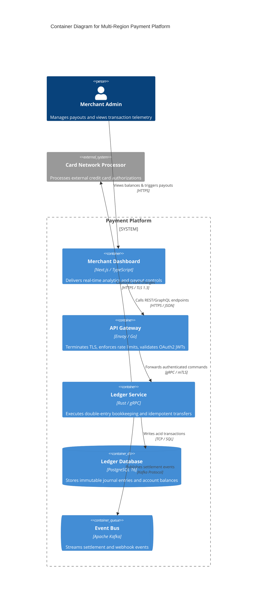
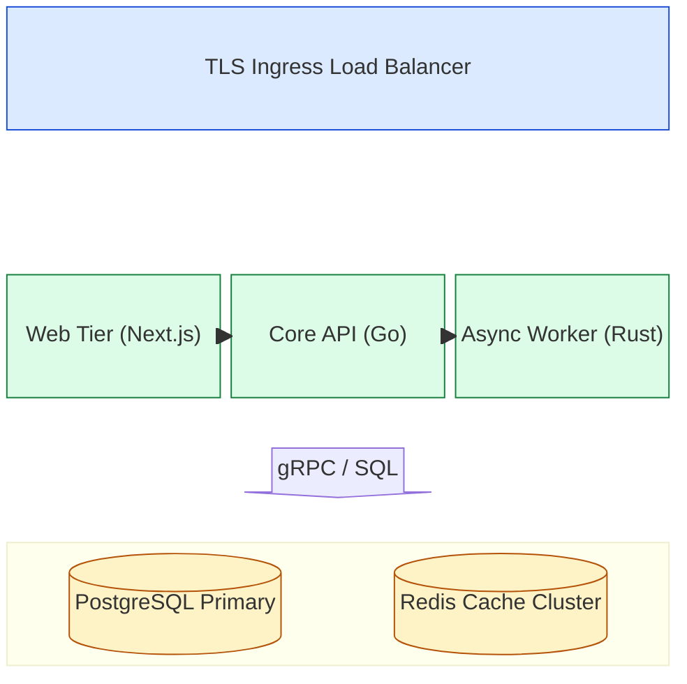
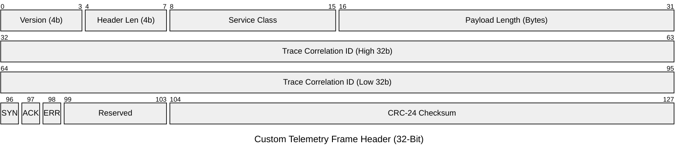

# Architecture, Cloud, Network & AI Agentflow Diagrams Reference

Authoritative Mermaid.js (v11.x – v12.2.0) syntax, layout tuning, and production templates for C4 models, Cloud Architecture (`architecture-beta`), AI Agentflow (`agentflow-beta`), Block (`block`), and Packet (`packet`) diagrams.

## Table of Contents
1. [C4 Architecture Suite (`C4Context`, `C4Container`, `C4Component`, `C4Dynamic`, `C4Deployment`)](#1-c4-architecture-suite)
2. [Cloud & Infrastructure Architecture (`architecture-beta`, v11.1+ / v11.16+)](#2-cloud--infrastructure-architecture-architecture-beta)
3. [AI Agent Orchestration (`agentflow-beta`, v12.0+)](#3-ai-agent-orchestration-agentflow-beta-v120)
4. [Block Grid Diagrams (`block` / `block-beta`)](#4-block-grid-diagrams-block--block-beta)
5. [Network Packet & Register Diagrams (`packet` / `packet-beta`)](#5-network-packet--register-diagrams-packet--packet-beta)

---

## 1. C4 Architecture Suite

### 5 C4 Declaration Keywords
1. `C4Context`: Level 1 — System Context (Actors, core system, external dependencies)
2. `C4Container`: Level 2 — Containers (Web apps, APIs, databases, message queues)
3. `C4Component`: Level 3 — Components (Internal controllers, repositories, domain services)
4. `C4Dynamic`: Dynamic numbered interaction flow across containers/components
5. `C4Deployment`: Infrastructure deployment nodes (Cloud regions, VPCs, K8s pods)

### Element & Boundary Macros
- **Context Elements**:
  - `Person(alias, "Label", "Optional Description")` / `Person_Ext(...)`
  - `System(alias, "Label", "Optional Description")` / `System_Ext(...)`
  - `SystemDb(alias, "Label", "Descr")` / `SystemQueue(alias, "Label", "Descr")`
- **Container Elements**:
  - `Container(alias, "Label", "Technology", "Description")` / `Container_Ext(...)`
  - `ContainerDb(alias, "Label", "Technology", "Description")`
  - `ContainerQueue(alias, "Label", "Technology", "Description")`
- **Component Elements**:
  - `Component(alias, "Label", "Technology", "Description")`
  - `ComponentDb(...)` / `ComponentQueue(...)`
- **Boundaries (`{ ... }` blocks)**:
  - `Enterprise_Boundary(alias, "Label") { ... }`
  - `System_Boundary(alias, "Label") { ... }`
  - `Container_Boundary(alias, "Label") { ... }`
  - `Boundary(alias, "Label", "Custom Type") { ... }`
- **Deployment Nodes (`{ ... }` blocks)**:
  - `Deployment_Node(alias, "Label", "Technology", "Description") { ... }`
- **Relationships & Styling**:
  - `Rel(from, to, "Label", "Optional Technology")` / `BiRel(from, to, "Label", "Tech")`
  - `UpdateElementStyle(alias, $bgColor="#1e40af", $fontColor="#ffffff", $borderColor="#1e3a8a")`
  - `UpdateRelStyle(from, to, $textColor="#2563eb", $lineColor="#2563eb", $offsetX="-30", $offsetY="20")`
  - `UpdateLayoutConfig($c4ShapeInRow="3", $c4BoundaryInRow="1")`

### Production C4 Container Template


### C4 Pitfalls
1. **Never use PlantUML `Lay_U` / `Lay_L` or `AddElementTag`**: Mermaid C4 uses a deterministic grid layout controlled only by declaration order and `UpdateLayoutConfig($c4ShapeInRow="...", $c4BoundaryInRow="...")`.
2. **Overlapping relationship labels**: Use `UpdateRelStyle(from, to, $offsetX="-40", $offsetY="20")` at the bottom of the diagram to nudge colliding text.

---

## 2. Cloud & Infrastructure Architecture (`architecture-beta`)

### Core Building Blocks (v11.1.0+ / v11.16.0+)
- **Declaration**: `architecture-beta`
- **Built-in Icons**: `(cloud)`, `(database)`, `(disk)`, `(internet)`, `(server)`. (Custom Iconify packs like `(logos:aws-lambda)` work when registered).
- **Groups**: `group <groupId>(<icon>)[<Title>]` or nested `group <childId>(<icon>)[<Title>] in <parentId>`
- **Services**: `service <serviceId>(<icon>)[<Title>]` or `service <serviceId>(<icon>)[<Title>] in <groupId>`
- **Junctions**: `junction <junctionId>` or `junction <junctionId> in <groupId>` (4-way routing hub)

### Mandatory Port Sides (`:L`, `:R`, `:T`, `:B`) & `{group}` Boundary Modifier
Every edge endpoint **must** specify which side of the node it exits/enters (`:L` Left, `:R` Right, `:T` Top, `:B` Bottom) with **no spaces around `:`**:
- Direct service-to-service: `gateway:R --> L:app_server`
- Crossing group boundaries (`{group}` modifier):
  `app_server{group}:B --> T:replica_db{group}`
  *(Never use a `groupId` directly in an edge; always reference a `serviceId` inside the group with `{group}` appended!)*

### Sibling Alignment (`align row` / `align column`, v11.16.0+)
When multiple sibling services have identical port connections (e.g., two databases both connecting `L:db` from `app:R`), the `fcose` solver may stack them at the same coordinate. Prevent overlap with `align`:
- `align column <service1> <service2> [<service3>...]` (stacks vertically along shared X)
- `align row <service1> <service2> [<service3>...]` (spreads horizontally along shared Y)

### Production Cloud Architecture Template


---

## 3. AI Agent Orchestration (`agentflow-beta`, v12.0+)

### Syntax Rules (Tier 1 — Fallback to `flowchart TB` for Tier 2/3)
- **Declaration**: `agentflow-beta TB` (or `LR`)
- **6 Semantic Agent Shapes (`@{ shape: <type> }`)**:
  - `task` (`roundedRect`): Agent reasoning or transformation step
  - `tool` (`subroutine`): External tool/MCP invocation (bind via `connectorRef: "connId.method"`)
  - `input` (`lean-right`): User prompt or context input
  - `decision` (`diamond`): Guardrail, evaluation, or routing check
  - `refdoc` (`lin-doc`): Skill file, RAG index, or system prompt document
  - `action` (`hexagon`): Final side-effecting delivery
- **3 Semantic Edge Types**:
  - `A --> B`: Sequential control/data handoff
  - `A -.- B`: Read-only reference consultation (e.g., reading a `refdoc`)
  - `A --x B`: Error/fallback transition on validation failure

### Production Agentflow Template
```mermaid
agentflow-beta TB
    connector mcp_db["PostgreSQL MCP"]
    mcp_db@{ protocol: "stdio", endpoint: "mcp://postgres-prod" }

    global
        policy["Security Policy Skill"]@{ shape: refdoc }
    end

    flow orchestrator["Autonomous Triage & Remediation Agent"]
        alert["PagerDuty Alert"]@{ shape: input, value: "High 5xx Latency" }
        query["inspect_slow_queries"]@{ shape: tool, connectorRef: "mcp_db.query", params: "window :: 15m", returns: "QueryPlan[]" }
        analyze["Synthesize Root Cause"]@{ shape: task }
        safe{"Safe to Auto-Index?"}@{ shape: decision }
        escalate["Escalate to On-Call"]@{ shape: action }
        mitigate["Apply Non-Blocking Index"]@{ shape: action }

        alert --> query --> analyze --> safe
        analyze -.- policy
        safe -- "Yes" --> mitigate
        safe -- "No" --> escalate
        query --x escalate
    end
    orchestrator@{ model: "gemini-4-argon", instruction: "Verify read-only safety before proposing DDL." }
```

---

## 4. Block Grid Diagrams (`block` / `block-beta`)

### Syntax Rules
- **Declaration**: `block` (or `block-beta` for GitHub Tier 2 compatibility).
- **Grid Columns**: `columns <N>` sets the exact column count per row.
- **Spanning**: Append `:N` to any block or `space` token (`Header["System Bus"]:3`, `space:2`).
- **Nested Blocks**: `block:groupId:2 ... end` creates a composite block spanning 2 parent columns that can declare its own internal `columns`.
- **Block Arrows**: `arrowId<["Label"]>(right | left | up | down | x | y)`.



---

## 5. Network Packet & Register Diagrams (`packet` / `packet-beta`)

### Syntax Rules (v11.0+ / v12.0+)
- **Declaration**: `packet` (or `packet-beta` for GitHub Tier 2 compatibility).
- **Bit Ranges**:
  - Explicit start-end: `0-15: "Source Port"`
  - Single bit flag: `31: "ACK"`
  - Relative bit width (v11.7+): `+16: "Destination Port"` (automatically calculates start bit from previous field's end bit).
- **Config (`config.packet`)**:
  - `bitsPerRow`: `32` (default; set to `8` or `16` for hardware registers).
  - `showBits`: `true` (default).
  - `bitOrder`: `'ascending'` (default network order, bit 0 on left) or `'descending'` (v12.0+ hardware register order, MSB on left, bit 0 on right).


