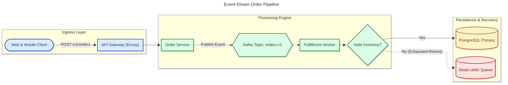
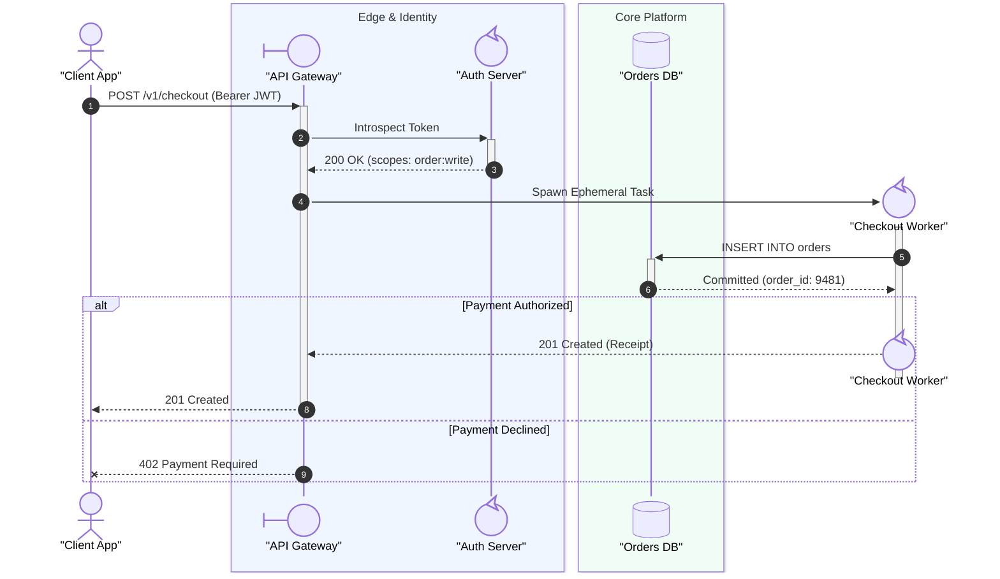
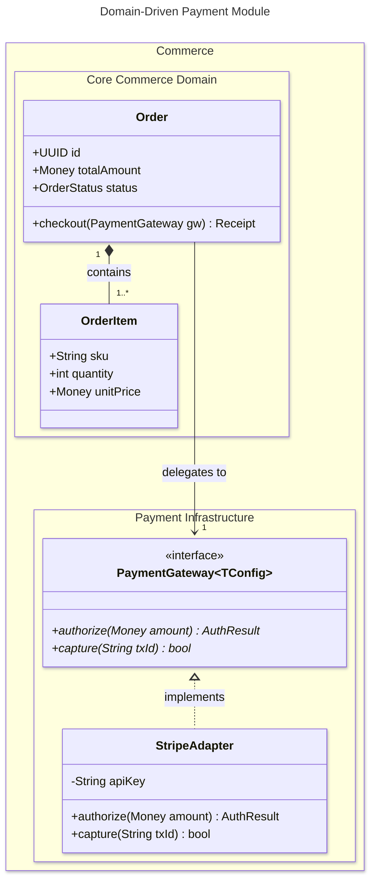
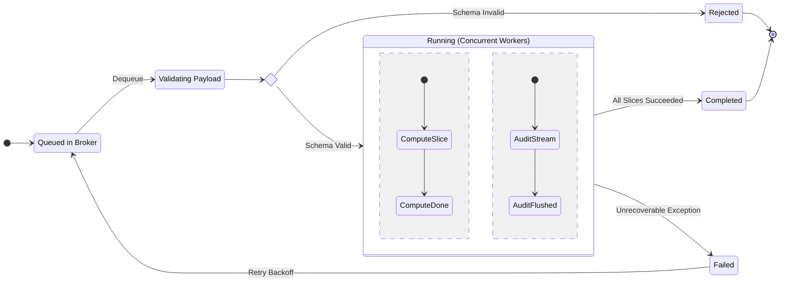

# Core Software & UML Diagrams Reference

Authoritative Mermaid.js (v11.x – v12.2.0) syntax, modern features, production templates, and syntax-breaker workarounds for the 7 core software engineering and UML diagram types.

## Table of Contents
1. [Flowchart (`flowchart` / `graph`)](#1-flowchart-flowchart--graph)
2. [Sequence Diagram (`sequenceDiagram`)](#2-sequence-diagram-sequencediagram)
3. [Class Diagram (`classDiagram`)](#3-class-diagram-classdiagram)
4. [State Diagram (`stateDiagram-v2`)](#4-state-diagram-statediagram-v2)
5. [Entity Relationship Diagram (`erDiagram`)](#5-entity-relationship-diagram-erdiagram)
6. [Use Case Diagram (`usecase-beta`, v12.0+)](#6-use-case-diagram-usecase-beta-v120)
7. [ZenUML Sequence Diagram (`zenuml`)](#7-zenuml-sequence-diagram-zenuml)

---

## 1. Flowchart (`flowchart` / `graph`)

### Declaration, Direction & v12 Defaults
- **Keywords**: Always prefer `flowchart <DIRECTION>` over legacy `graph <DIRECTION>`.
- **Directions**:
  - `TD` or `TB`: Top-to-Bottom (best for hierarchical trees and multi-tier architectures)
  - `LR`: Left-to-Right (best for pipelines, workflows, and request lifecycles)
  - `BT`: Bottom-to-Top
  - `RL`: Right-to-Left
- **v12.0+ Defaults**: Uses `theme: redux-color`, `look: neo`, and `layout: elk` by default.

### Classic Node Shapes (14 Shapes — Tier 1, 2 & 3 Compatible)
| Syntax | Shape Name | Semantic Usage |
| :--- | :--- | :--- |
| `id["Label"]` | Rectangle | Standard process, service, or step |
| `id("Label")` | Rounded Rectangle | Start/event step or lightweight action |
| `id(["Label"])` | Stadium / Pill | Terminal start/stop point or external trigger |
| `id[["Label"]]` | Subroutine | Predefined subprocess, library call, or module |
| `id[("Label")]` | Cylinder | Database, persistent store, or cache |
| `id(("Label"))` | Circle | Connector, state hub, or small junction |
| `id((("Label")))` | Double Circle | Final termination or stop state |
| `id>"Label"]` | Asymmetric / Flag | Signal, webhook, or external notification |
| `id{"Label"}` | Rhombus / Diamond | Conditional branch or decision gate |
| `id{{"Label"}}` | Hexagon | Preparation step, message bus, or queue |
| `id[/"Label"/]` | Parallelogram (Lean Right) | Data input / output payload |
| `id[\"Label"\]` | Parallelogram (Lean Left) | Asynchronous output / input |
| `id[/"Label"\]` | Trapezoid (Base Bottom) | Priority action |
| `id[\"Label"/]` | Trapezoid (Base Top) | Manual human operation |

### Expanded Node Shapes (`@{ shape: ... }`, v11.3.0+ — Tier 1 & 2)
Syntax: `NodeId@{ shape: <shapeName>, label: "<Label Text>" }`

| Category | Shape Short Names & Aliases |
| :--- | :--- |
| **Process & Control** | `rect` (`proc`), `rounded` (`event`), `stadium` (`terminal`, `pill`), `subproc` (`subprocess`, `fr-rect`), `div-rect` (divided process), `lin-rect` (lined/shaded process), `tag-rect` (tagged process), `processes` (`procs`, stacked multi-process), `notch-rect` (`card`), `sl-rect` (`manual-input`), `trap-b` (`priority`), `trap-t` (`manual`), `fork` (`join`), `delay` (half-rounded), `hourglass` (`collate`), `notch-pent` (`loop-limit`), `tri` (`extract`), `flip-tri` (`manual-file`), `curv-trap` (`display`) |
| **Data & Storage** | `cyl` (`db`, `cylinder`), `das` (horizontal cylinder / direct access storage), `lin-cyl` (`disk`), `datastore` (top/bottom border), `win-pane` (`internal-storage`), `bow-rect` (`stored-data`), `lean-r` (`in-out`), `lean-l` (`out-in`), `flag` (`paper-tape`) |
| **Documents & Annotations** | `doc` (`document`), `docs` (stacked multi-document), `lin-doc` (lined document), `tag-doc` (tagged document), `text` (borderless text), `comment` (`brace`, left curly brace), `brace-r` (right brace), `braces` (both braces) |
| **Connectors & Decisions** | `diamond` (`diam`), `hex` (`hexagon`), `circle` (`circ`), `sm-circ` (`start`), `dbl-circ` (double circle), `framed-circle` (`stop`), `f-circ` (`junction`), `cross-circ` (`summary`), `odd`, `bolt` (communication link lightning bolt) |

### Icon & Image Nodes (v11.3.0+)
```mermaid
flowchart LR
    User@{ icon: "fa:user", form: "circle", label: "Customer", pos: "b", h: 56 }
    Logo@{ img: "https://mermaid.js.org/favicon.svg", label: "Portal", pos: "b", w: 48, h: 48, constraint: "on" }
    User --> Logo
```
- **Icon Properties**: `icon` (`"pack:name"`), `form` (`"square" | "circle" | "rounded"`), `label`, `pos` (`"t" | "b"`), `h` (height $\ge 48$).
- **Image Properties**: `img` (URL), `label`, `pos` (`"t" | "b"`), `w`, `h`, `constraint` (`"on" | "off"`).

### Edge Syntax, Edge IDs, Animation & Per-Edge Curves
| Style | Undirected | Directed | Labeled | Bidirectional / Special |
| :--- | :--- | :--- | :--- | :--- |
| **Solid** | `A --- B` | `A --> B` | `A -->\|"Label"\| B` or `A -- "Label" --> B` | `A <--> B` |
| **Dotted** | `A -.- B` | `A -.-> B` | `A -. "Label" .-> B` | `A <-.-> B` |
| **Thick** | `A === B` | `A ==> B` | `A == "Label" ==> B` | `A <==> B` |
| **Circle / Cross** | — | `A --o B` / `A --x B` | `A -- "Label" --o B` | `A o--o B` / `A x--x B` |
| **Invisible** | `A ~~~ B` | — | *(Forces layout rank alignment)* | — |

- **Rank Spanning**: Add extra dashes/dots/equals (`--->`, `---->`, `-..->`, `===>`) to push target nodes further down/right by additional ranks.
- **Edge IDs, Animation & Curves (v11.3+ / v11.10+)**:
  Attach `<edgeId>@` immediately before the arrow operator:
  ```mermaid
  flowchart LR
      A e1@-->|"Stream"| B
      B e2@-.->|"Retry"| A
      e1@{ animate: true, animation: fast, curve: natural }
      e2@{ animate: true, animation: slow, curve: stepBefore }
  ```
  - Valid D3 `curve` values: `basis`, `bumpX`, `bumpY`, `cardinal`, `catmullRom`, `linear`, `monotoneX`, `monotoneY`, `natural`, `step`, `stepAfter`, `stepBefore`.

### Subgraphs & Collapsible Subgraphs (v11.17.0+)
- Always give subgraphs an explicit alphanumeric ID and a quoted bracketed title: `subgraph sg_api ["API Layer"]`.
- **Collapsible Subgraphs (v11.17.0+)**:
  ```mermaid
  flowchart LR
      Client["Client"] --> auth_sg
      subgraph auth_sg ["Authentication Cluster"]
          OAuth["OAuth2 Server"] --> Token["JWT Signer"]
      end
      auth_sg --> Core["Core API"]
      auth_sg@{ view: collapsed }
  ```

### Production Flowchart Template


### Flowchart Pitfalls
1. **Lowercase `end`**: Never name a node `end` (`A --> end` crashes the parser). Use `End` or `end_node["end"]`.
2. **Unspaced `o` or `x` after `---`**: `A---oB` parses as a circle edge to `B`. Write `A --- oB` or quote labels.
3. **Subgraph `direction` ignored**: If any internal node of a subgraph links directly to an external node, the subgraph's `direction` is ignored. Link external nodes to the `subgraphId` instead.
4. **Commas in `classDef` `stroke-dasharray`**: Escape commas with a backslash: `stroke-dasharray: 5\,5`.

---

## 2. Sequence Diagram (`sequenceDiagram`)

### Participants, Actors & Stereotype Shapes (`@{ "type": ... }`)
Declare participants explicitly at the top to control horizontal lifeline ordering:
- `participant ID as "Display Label"` (rectangle box)
- `actor User as "End User"` (stick figure)
- **Stereotype Shapes**:
  `participant Name@{ "type": "<stereotype>" } as "Display Label"`
  - `"boundary"` (UI / Gateway boundary symbol)
  - `"control"` (Controller / Orchestrator symbol)
  - `"entity"` (Domain entity symbol)
  - `"database"` (Cylinder DB symbol)
  - `"collections"` (Multi-instance stacked box)
  - `"queue"` (Horizontal queue cylinder)

### Dynamic Actor Creation & Destruction (`create` / `destroy`)
- Place `create participant <Name>` immediately before the message where `<Name>` is the **recipient**.
- Place `destroy <Name>` immediately before the final message where `<Name>` is either the **sender or recipient**.

### Complete Arrow Operator Table (v11.0+ & v11.12.3+)
| Solid | Dotted | Arrowhead / Meaning |
| :---: | :---: | :--- |
| `->>` | `-->>` | Standard filled arrowhead (Synchronous request / response) |
| `->` | `-->` | Line without arrowhead |
| `<<->>` | `<<-->>` | **Bidirectional** filled arrowheads (v11.0.0+) |
| `-)` | `--)` | Open arrowhead (Asynchronous fire-and-forget message) |
| `-x` | `--x` | Cross termination (Failed / rejected / timeout message) |
| `-\` / `-/` | `--\` / `--/` | Top / Bottom filled half-arrowheads (v11.12.3+) |
| `-\` / `-//` | `--\\` / `--//` | Top / Bottom stick half-arrowheads (v11.12.3+) |

- **Activation Shorthand**: Append `+` to activate target (`A->>+B: Call`) and `-` to deactivate source (`B-->>-A: Return`).
- **Central Lifeline Connections (`()`, v11.12.3+)**: Attach `()` to sender/receiver (`Alice->>()Bob: Msg`) to anchor the arrow at the center of the lifeline/activation bar.
- **Autonumbering (v11.15.0+)**: `autonumber` or `autonumber <start> <increment>` (e.g., `autonumber 10 10` or `autonumber 1.1 0.1`).

### Control Flow Fragments & Grouping
- **Grouping Lifelines**: `box rgb(240, 249, 255) "Internal Services" ... end` (or `box transparent "Title"`).
- **Fragments**:
  - `alt <Condition> ... else <Other> ... end`
  - `opt <Optional Condition> ... end`
  - `loop <Interval/Condition> ... end`
  - `par <Branch 1> ... and <Branch 2> ... end`
  - `critical <Action> ... option <Failure Mode> ... end`
  - `break <Fatal Condition> ... end`
  - `rect rgba(37, 99, 235, 0.08) ... end`

### Production Sequence Diagram Template


### Sequence Diagram Pitfalls
1. **Never use `#hex` colors in `box` or `rect`**: `#` starts a comment/entity in `sequenceDiagram`. Always use `rgb(r, g, b)`, `rgba(r, g, b, a)`, or CSS color names (`Aqua`).
2. **Box titles starting with CSS color names**: `box Red Team` sets the box background to red and titles it `"Team"`. Use `box transparent Red Team` if `"Red"` is part of the title.
3. **Unescaped semicolons `;`**: Semicolons terminate statements; write `#59;` for a literal semicolon in message text.
4. **Orphan `create` / `destroy`**: Every `create` or `destroy` statement must be followed on the very next line by a message involving that participant.

---

## 3. Class Diagram (`classDiagram`)

### Syntax Rules & v11.15+ Features
- **Visibility**: `+` (Public), `-` (Private), `#` (Protected), `~` (Package/Internal).
- **Classifiers (placed at end of member line)**: `*` (Abstract method, e.g., `+execute() void*`), `$` (Static field/method, e.g., `+getInstance() Service$`).
- **Generics**: Wrap in tildes `~T~` (e.g., `class Repository~Entity~`). Note: Commas inside `~K, V~` are not supported by the lexer; use `~Key_Value~` instead.
- **8 Relationship Arrows**:
  - `<|--` / `--|>`: Inheritance
  - `*--` / `--*`: Composition
  - `o--` / `--o`: Aggregation
  - `<--` / `-->`: Association
  - `--`: Solid Link
  - `<..` / `..>`: Dependency
  - `<|..` / `..|>`: Realization (Interface implementation)
  - `..`: Dashed Link
- **Labeled & Nested Namespaces (v11.15.0+)**:
  `namespace Domain.Auth["Authentication Module"] { class TokenService }`

### Production Class Diagram Template


---

## 4. State Diagram (`stateDiagram-v2`)

### Syntax Rules
- Always declare `stateDiagram-v2`.
- **Start / End**: `[*] --> StateA` and `StateB --> [*]`.
- **State Aliases**: `state "Awaiting Payment Confirmation" as AwaitingPayment`.
- **Composite States**: `state ActiveSession { ... }`.
- **Orthogonal Concurrency (`--`)**: Separate parallel state regions inside a composite state using `--`.
- **Pseudostates**:
  - `state check_balance <<choice>>`
  - `state fork_tasks <<fork>>`
  - `state join_tasks <<join>>`

### Production State Diagram Template


### State Diagram Pitfalls
1. **No Cross-Composite Inner Transitions**: Never draw an arrow directly from an inner state inside Composite A to an inner state inside Composite B; connect to the outer composite state ID.
2. **Never style `[*]`**: Applying `classDef` or `:::` to `[*]` fails.

---

## 5. Entity Relationship Diagram (`erDiagram`)

### Crow's Foot Cardinality & Identification
| Left | Right | Cardinality Meaning | Verbal Alias |
| :---: | :---: | :--- | :--- |
| `\|o` | `o\|` | Zero or one (`0..1`) | `zero or one` |
| `\|\|` | `\|\|` | Exactly one (`1..1`) | `only one` / `1` |
| `}o` | `o{` | Zero or more (`0..N`) | `zero or more` / `0+` |
| `}\|` | `\|{` | One or more (`1..N`) | `one or more` / `1+` |

- **Solid Line (`--`)**: Identifying relationship (child key depends on parent).
- **Dashed Line (`..`)**: Non-identifying relationship.
- **Attributes**: `<type> <name> [PK, FK, UK] ["comment"]`. Supports nullable `type?` (v11.16.0+) and array `type[]`.
- **ER Subgraphs (v11.17.0+)**: Group entities into bounded contexts using `subgraph id [Domain Title] ... end`.

### Production ER Diagram Template
```mermaid
erDiagram
    accTitle: Multi-Tenant SaaS Billing Schema
    accDescr: Entity relationship schema across Identity and Billing domains with primary, foreign, and unique keys.
    direction LR

    subgraph identity_ctx ["Identity Bounded Context"]
        ORGANIZATION ||--|{ USER_ACCOUNT : "employs"
        ORGANIZATION {
            uuid id PK "Tenant identifier"
            string slug UK "URL-safe tenant handle"
            string name "Legal organization name"
        }
        USER_ACCOUNT {
            uuid id PK
            uuid org_id FK
            string email UK
            string? phone_number "Optional MFA phone (v11.16+)"
        }
    end

    subgraph billing_ctx ["Billing Bounded Context"]
        SUBSCRIPTION ||--o{ INVOICE : "generates"
        SUBSCRIPTION {
            uuid id PK
            uuid org_id FK
            string plan_tier "free | pro | enterprise"
            timestamp current_period_end
        }
        INVOICE {
            uuid id PK
            uuid subscription_id FK
            int amount_cents
            string status "draft | open | paid | void"
        }
    end

    ORGANIZATION ||--o| SUBSCRIPTION : "subscribes to"
```

---

## 6. Use Case Diagram (`usecase-beta`, v12.0+)

### Syntax Rules (Tier 1 — Fallback to `flowchart LR` for Tier 2/3)
- **Declaration**: `usecase-beta`
- **Actors**: Must be explicitly declared (`actor Customer("Customer")` or `actor Staff("Staff")@{ type: hollow, business: true } <<Employee>>`).
- **System Boundary**: `systemBoundary id["Title"]@{ type: package } ... end` (contains only actor and use-case declarations; declare edges outside at top level).
- **UML Relationships**:
  - Association: `Customer --> Checkout` or `Customer -- "initiates" --> Checkout`
  - Include: `Checkout ..> : include ProcessPayment`
  - Extend: `ApplyCoupon ..> : extend Checkout`
  - Generalization: `VIPCustomer --|> Customer`

```mermaid
usecase-beta
    accTitle: E-Commerce Checkout Use Cases
    accDescr: UML use case model showing Customer and Admin interactions with the Ordering System boundary.
    direction LR

    actor Customer("Retail Customer")
    actor Admin("Fraud Analyst")@{ type: hollow }

    systemBoundary checkout_sys["Checkout Subsystem"]@{ type: package }
        Browse("Browse Catalog")
        PlaceOrder("Place Order") <<Core>>
        VerifyPayment("Verify Payment")
        FlagFraud("Flag Suspicious Order")
    end

    Customer --> Browse
    Customer --> PlaceOrder
    PlaceOrder ..> : include VerifyPayment
    FlagFraud ..> : extend VerifyPayment
    Admin --> FlagFraud
```

---

## 7. ZenUML Sequence Diagram (`zenuml`)

### Syntax Rules
- **Declaration**: `zenuml`
- **Annotators**: `@Actor`, `@Boundary`, `@Control`, `@Entity`, `@Database`, `@Lambda`, `@S3`, `@SQS`, `@RDS`.
- **Messages**:
  - Sync (nestable with `{ ... }`): `OrderController.create(req) { ... }`
  - Async (colon, non-nestable): `Client->OrderController: POST /orders`
  - Return: `return response` or `@return` above `A->B: result`.
- **Comments**: Use `// Markdown comment` (never `%%`).
