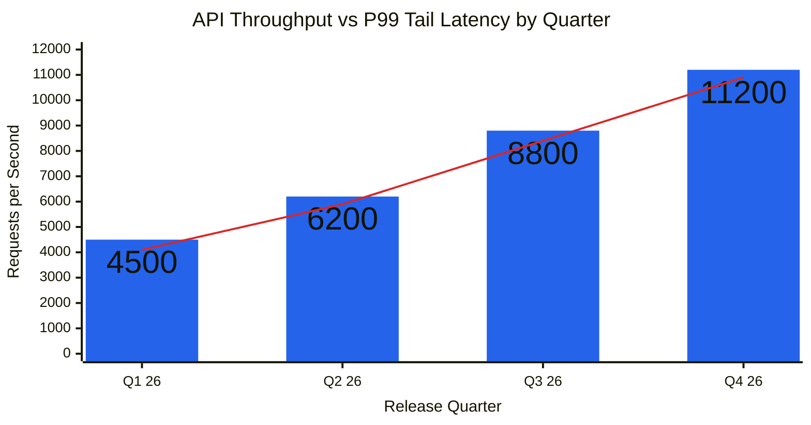
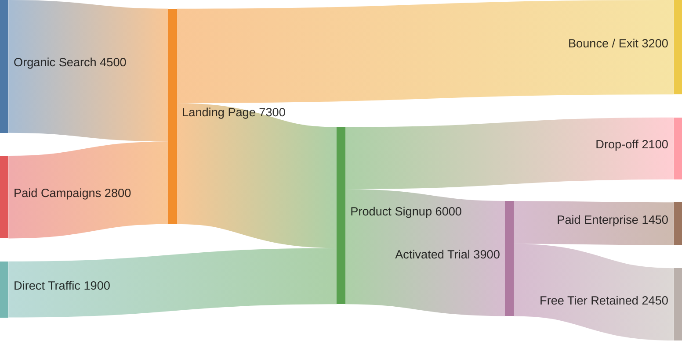
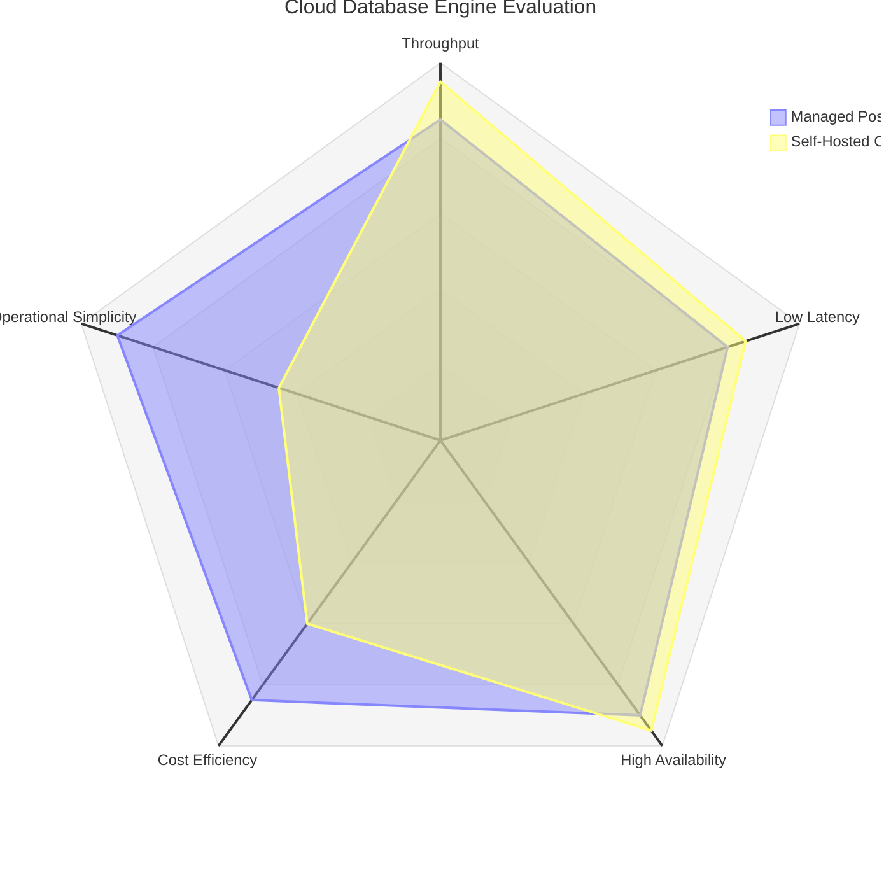
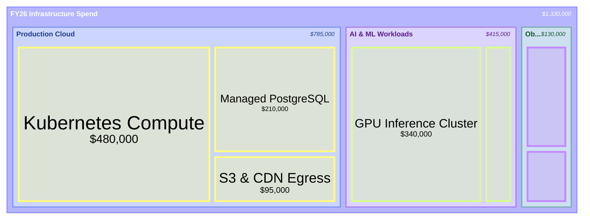
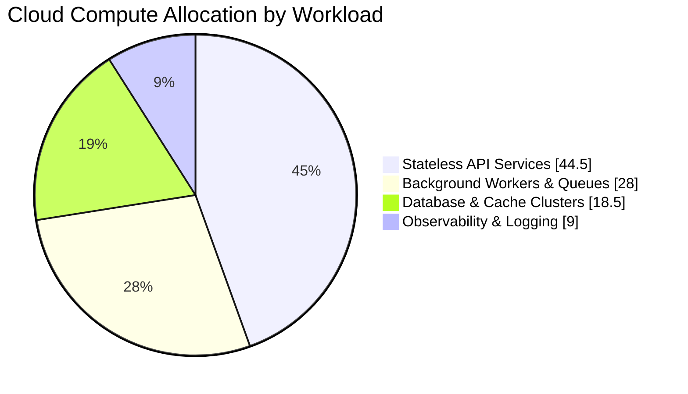
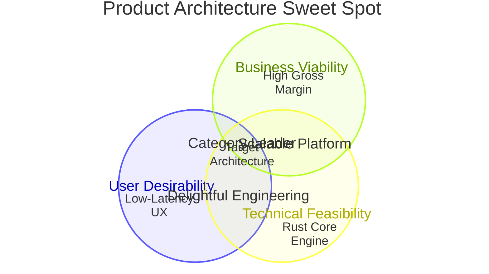

# Data Charts & Analytics Diagrams Reference

Authoritative Mermaid.js (v11.x – v12.2.0) syntax, configuration options, and production templates for quantitative and analytical visualizations: XY Charts (`xychart-beta`), Sankey (`sankey-beta`), Quadrant (`quadrantChart`), Radar (`radar-beta`), Treemap (`treemap-beta`), Pie/Donut (`pie`), and Venn (`venn-beta`).

## Table of Contents
1. [XY Bar & Line Charts (`xychart-beta`)](#1-xy-bar--line-charts-xychart-beta)
2. [Sankey Flow Diagrams (`sankey-beta`)](#2-sankey-flow-diagrams-sankey-beta)
3. [Quadrant Matrix Charts (`quadrantChart`)](#3-quadrant-matrix-charts-quadrantchart)
4. [Radar / Spider Charts (`radar-beta`, v11.6+)](#4-radar--spider-charts-radar-beta-v116)
5. [Proportional Treemaps (`treemap-beta`)](#5-proportional-treemaps-treemap-beta)
6. [Pie & Donut Charts (`pie`)](#6-pie--donut-charts-pie)
7. [Venn Set Overlap Diagrams (`venn-beta`, v11.12+)](#7-venn-set-overlap-diagrams-venn-beta-v1112)

---

## 1. XY Bar & Line Charts (`xychart-beta`)

### Syntax Rules (Tier 1, 2 & 3 Compatible)
- **Declaration**: Prefer `xychart-beta` (or `xychart-beta horizontal` for horizontal bar charts) for maximum Tier 1–3 compatibility.
- **Quoting Rule**: Any multi-word string in `title`, `x-axis`, `y-axis`, or series names **must** be enclosed in double quotes `"..."`.
- **Axes**:
  - Categorical `x-axis`: `x-axis "Quarter" ["Q1 2026", "Q2 2026", "Q3 2026", "Q4 2026"]`
  - Numeric `x-axis`: `x-axis "Latency (ms)" 0 --> 500`
  - Numeric `y-axis` (never categorical!): `y-axis "Throughput (req/s)" 0 --> 12000`
- **Series (`bar` and `line`)**:
  - Named series (v11.17+ auto-renders legend): `bar "Baseline" [4200, 5100, 6300, 7400]`
  - Unnamed series (Tier 2/3 safest): `bar [4200, 5100, 6300, 7400]`
  - Per-point labels on `line` (v11.16+): `line [4200 "v1.0", 5100, 8900 "v2.0 Launch", 10500]`

### Production XY Chart Template


---

## 2. Sankey Flow Diagrams (`sankey-beta`)

### Syntax Rules (Strict RFC 4180 3-Column CSV)
- **Declaration**: `sankey-beta` (or `sankey`).
- **Format**: Every non-empty, non-comment line **must** have exactly 3 comma-separated columns:
  `<Source Node>,<Target Node>,<Positive Numeric Value>`
- **Critical Rules**:
  1. **NO CSV Header Row**: Writing `source,target,value` without `%%` causes a fatal parse error because `"value"` is not a number.
  2. **No spaces after commas**: Write `A,B,10` (writing `A, B, 10` prefixes node `B` with a space).
  3. **Quoting commas & quotes**: Wrap node names containing commas in `"..."`, and escape internal double quotes by doubling them `""`: `"Tier 1, ""Primary""",Core,45.5`.
  4. **Acyclic DAG**: Avoid cycles (`A -> B -> A`).

### Production Sankey Template


---

## 3. Quadrant Matrix Charts (`quadrantChart`)

### Syntax Rules & Coordinate Mapping
- **Declaration**: `quadrantChart`
- **Axes**: Must use `-->` (two dashes and `>`):
  - `x-axis Low Effort --> High Effort`
  - `y-axis Low Impact --> High Impact`
- **Mathematical Counter-Clockwise Quadrant Numbering**:
  - `quadrant-1`: **Top-Right** ($x \ge 0.5, y \ge 0.5$)
  - `quadrant-2`: **Top-Left** ($x < 0.5, y \ge 0.5$)
  - `quadrant-3`: **Bottom-Left** ($x < 0.5, y < 0.5$)
  - `quadrant-4`: **Bottom-Right** ($x \ge 0.5, y < 0.5$)
- **Data Points**: `<Label>[:::<class>]: [<x>, <y>] [radius: N, color: #hex, stroke-width: Npx, stroke-color: #hex]`
  - Both `x` and `y` **must be normalized floats in `[0.0, 1.0]`**.

### Production Quadrant Chart Template
```mermaid
quadrantChart
    title Engineering Roadmap Prioritization Matrix
    x-axis Low Implementation Complexity --> High Implementation Complexity
    y-axis Low Customer Impact --> High Customer Impact
    quadrant-1 Strategic Bets (Plan Carefully)
    quadrant-2 Quick Wins (Execute Immediately)
    quadrant-3 Low Priority (Defer or Drop)
    quadrant-4 Time Sinks (Automate or Avoid)

    SSO Integration:::quickwin: [0.25, 0.85]
    Webhook Retries:::quickwin: [0.32, 0.78]
    Multi-Region Active-Active:::strategic: [0.82, 0.90]
    AI Query Copilot:::strategic: [0.70, 0.75]
    Legacy CSV Export: [0.20, 0.25]
    Custom Theme Builder: [0.78, 0.30]

    classDef quickwin color: #16a34a, radius: 12, stroke-width: 2px, stroke-color: #14532d
    classDef strategic color: #2563eb, radius: 14, stroke-width: 2px, stroke-color: #1e3a8a
```

---

## 4. Radar / Spider Charts (`radar-beta`, v11.6+)

### Syntax Rules
- **Declaration**: `radar-beta`
- **Axes**: `axis id1["Label 1"], id2["Label 2"], id3["Label 3"]`
- **Curves**:
  - Positional: `curve c1["Series A"]{85, 90, 75}`
  - Key-value map: `curve c2["Series B"]{ id1: 70, id2: 95, id3: 80 }`
- **Options**: `max <num>`, `min <num>`, `ticks <num>`, `graticule <circle | polygon>`, `showLegend <true | false>`.

### Production Radar Template


---

## 5. Proportional Treemaps (`treemap-beta`)

### Syntax Rules
- **Declaration**: `treemap-beta`
- **Hierarchy**: Indentation-based (spaces).
  - **Parent / Section Node**: Quoted string without colon or value (`"Engineering"`).
  - **Leaf Node**: Quoted string + `:` + numeric value (`"Cloud Compute": 420000`).
- **Styling**: Append `:::className` to any parent or leaf node and define `classDef` at the bottom.
- **Formatting**: Set `config.treemap.valueFormat` to `','`, `'$0,0'`, `'$,.2f'`, or `'.1%'`.



---

## 6. Pie & Donut Charts (`pie`)

### Syntax Rules & v11.16+ Donut Config
- **Declaration**: `pie` or `pie showData` (displays raw numeric values inside `[value]` in the legend).
- **Slices**: `"<Double-Quoted Label>" : <Positive Number > 0>`
  - Never use `0`, negative numbers, or `%` signs.
- **Donut Mode (v11.16.0+)**: Set `config.pie.donutHole: 0.4` (`0` to `0.9`), `legendPosition: right | bottom | top | left`, and `textPosition: 0.75`.



---

## 7. Venn Set Overlap Diagrams (`venn-beta`, v11.12+)

### Syntax Rules
- **Declaration**: `venn-beta`
- **Sets**: `set <id>["Display Label"]:<size>`
- **Intersections**: `union <id1>,<id2>[,<id3>]["Overlap Label"]:<size>`
- **Inner Items**: Indented `text <itemId>["Text"]` beneath a `set` or `union`.


