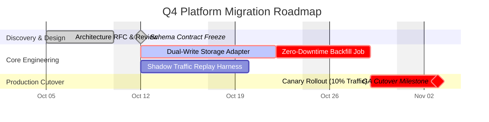
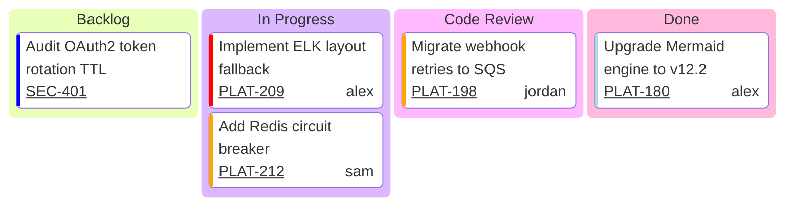
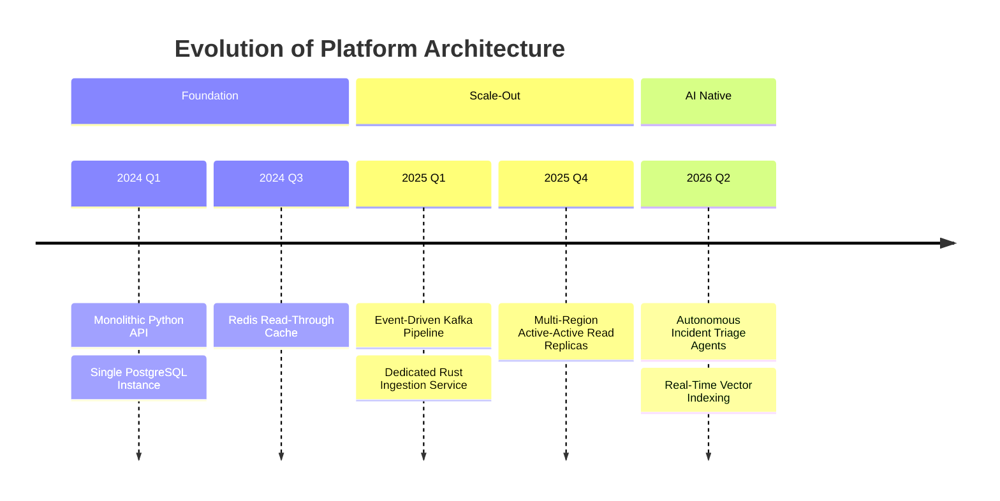
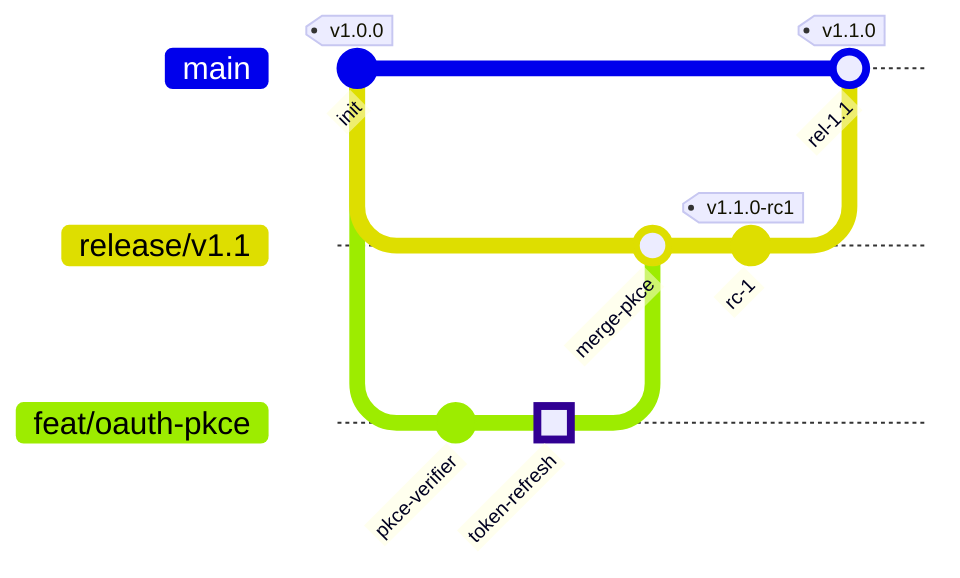
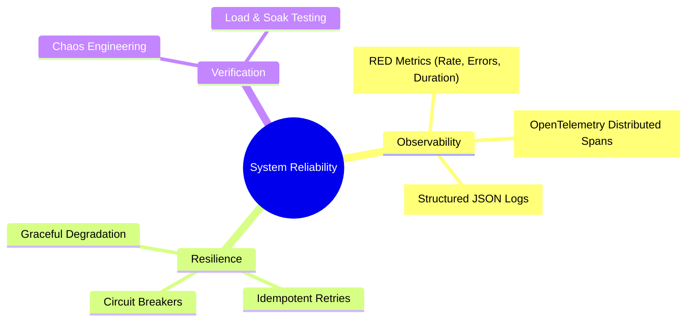
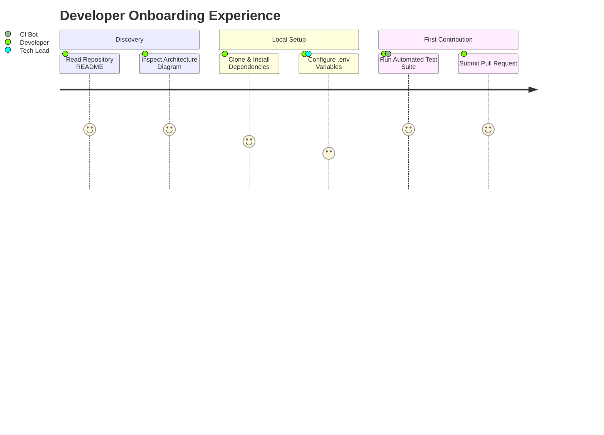
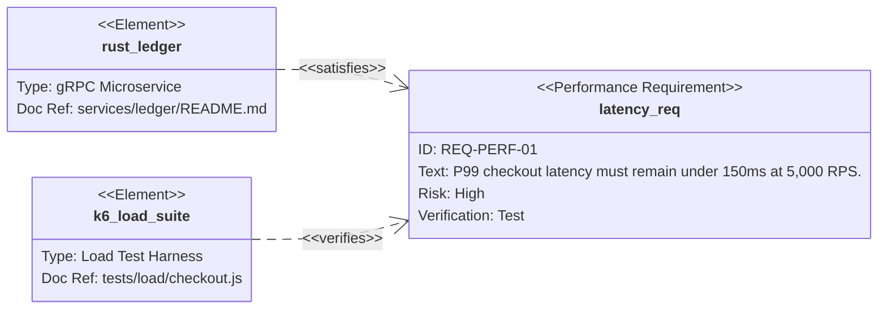
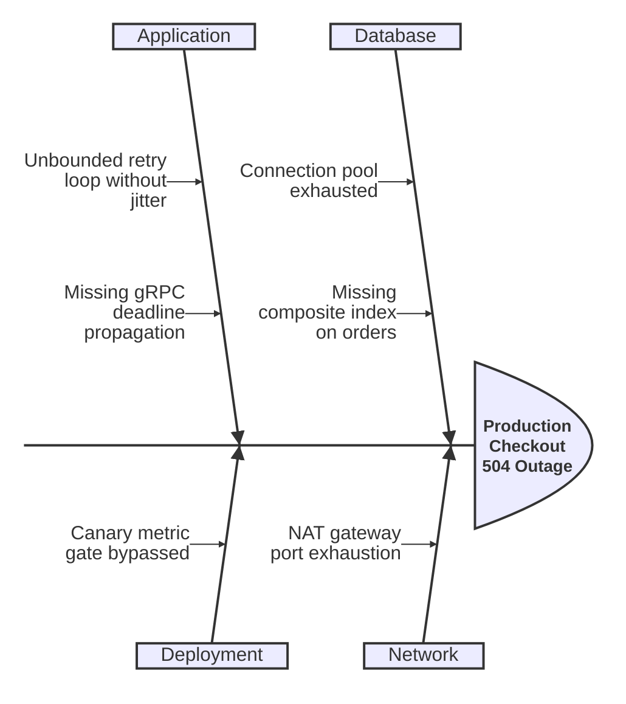

# Project, Workflow & Strategy Diagrams Reference

Authoritative Mermaid.js (v11.x – v12.2.0) syntax, configuration options, and production templates for project management, organizational workflows, version control, and strategic sense-making: Gantt (`gantt`), Swimlanes (`swimlane-beta`), Kanban (`kanban`), Timeline (`timeline`), GitGraph (`gitGraph`), Mindmap (`mindmap`), TreeView (`treeView-beta`), User Journey (`journey`), Requirement (`requirementDiagram`), Event Modeling (`eventmodeling`), Wardley Maps (`wardley-beta`), Cynefin (`cynefin-beta`), and Ishikawa (`ishikawa-beta`).

## Table of Contents
1. [Gantt Project Schedules (`gantt`)](#1-gantt-project-schedules-gantt)
2. [Swimlane Process Diagrams (`swimlane-beta`, v11.16+)](#2-swimlane-process-diagrams-swimlane-beta-v1116)
3. [Kanban Boards (`kanban`)](#3-kanban-boards-kanban)
4. [Chronological Timelines (`timeline`)](#4-chronological-timelines-timeline)
5. [Git Branching Graphs (`gitGraph`)](#5-git-branching-graphs-gitgraph)
6. [Hierarchical Mindmaps (`mindmap`)](#6-hierarchical-mindmaps-mindmap)
7. [Directory TreeViews (`treeView-beta`, v11.14+)](#7-directory-treeviews-treeview-beta-v1114)
8. [User Journey Maps (`journey`)](#8-user-journey-maps-journey)
9. [SysML Requirement Diagrams (`requirementDiagram`)](#9-sysml-requirement-diagrams-requirementdiagram)
10. [CQRS Event Modeling (`eventmodeling`, v11.15+)](#10-cqrs-event-modeling-eventmodeling-v1115)
11. [Wardley Value-Chain Maps (`wardley-beta`, v11.14+)](#11-wardley-value-chain-maps-wardley-beta-v1114)
12. [Cynefin Sense-Making (`cynefin-beta`) & Ishikawa Fishbone (`ishikawa-beta`)](#12-cynefin-sense-making-cynefin-beta--ishikawa-fishbone-ishikawa-beta)

---

## 1. Gantt Project Schedules (`gantt`)

### Syntax Rules & Tag Ordering Law
- **Directives**:
  - `dateFormat YYYY-MM-DD` (Day.js input format tokens)
  - `axisFormat %Y-%m-%d` (D3 `%` output format tokens)
  - `tickInterval <1..N><millisecond|second|minute|hour|day|week|month>` (singular unit! Never `2weeks` or `1year`).
  - `excludes weekends, 2026-12-25` (Never use `weekdays` in `excludes`).
  - `weekend saturday` (default Sat–Sun) or `weekend friday` (Fri–Sat, v11.0+).
- **Task Metadata Order (CRITICAL)**:
  `<Task Title> : [done|active|crit|milestone|vert,] [taskID,] [startDate | after <id1 id2>,] <endDate | duration | until <id>>`
  - **Tags (`done`, `active`, `crit`, `milestone`, `vert`) MUST appear immediately after `:` and BEFORE `taskID`!**
  - Task titles must **never** contain a literal `:` (which splits title from metadata).

### Production Gantt Template


---

## 2. Swimlane Process Diagrams (`swimlane-beta`, v11.16+)

### Syntax Rules & Tier 2/3 Fallback
- **Tier 1 Keyword**: `swimlane-beta LR` (or `TB`) with `subgraph laneId [Lane Title] ... end` lanes.
- **Tier 2/3 Fallback**: Replace `swimlane-beta LR` with `flowchart LR`—the exact same `subgraph` and node/edge body renders cleanly in GitHub and strict previewers!

```mermaid
swimlane-beta LR
    accTitle: Cross-Departmental Order Fulfillment Swimlanes
    accDescr: Tracks an order across Customer, Warehouse, and Finance lanes.

    subgraph cust ["Customer Lane"]
         place["Submit Order"]
         receive(["Receive Shipment"])
    end

    subgraph wh ["Warehouse Lane"]
        pick["Reserve & Pack Inventory"]
        in_stock{"Stock Available?"}
        ship["Dispatch Carrier"]
    end

    subgraph fin ["Finance Lane"]
        capture["Capture Card Hold"]
        refund["Void Authorization"]
    end

    place --> pick --> in_stock
    in_stock -->|"Yes"| capture --> ship --> receive
    in_stock -->|"No"| refund
```

---

## 3. Kanban Boards (`kanban`)

### Syntax Rules
- **Declaration**: `kanban`
- **2-Level Indentation**:
  - Level 1 (Columns): `colId[Column Title]`
  - Level 2 (Tasks): `taskId[Task Title]@{ assigned: 'user', ticket: 'PROJ-101', priority: 'Very High' | 'High' | 'Low' | 'Very Low' }`
- **Strict Priority Enum**: Only `'Very High'`, `'High'`, `'Low'`, and `'Very Low'` are valid (`'Medium'` is invalid and breaks rendering!).



---

## 4. Chronological Timelines (`timeline`)

### Syntax Rules (v11.14+ Direction Support)
- **Declaration**: `timeline` (horizontal default) or `timeline TD` (top-down vertical, v11.14+).
- **Syntax**: `{Time Period} : {Event 1} : {Event 2}` or continuation lines starting with `: {Event}`.
- **Pitfall**: Never use a literal colon `:` inside a time period or event description (use `-` or `;` instead).



---

## 5. Git Branching Graphs (`gitGraph`)

### Syntax Rules
- **Declaration**: `gitGraph LR:` (default), `gitGraph TB:`, or `gitGraph BT:` (include the trailing colon `:`).
- **Statements**:
  - `commit id: "c1" type: NORMAL | REVERSE | HIGHLIGHT tag: "v1.0.0"`
  - `branch "feature/auth" order: 2` (always quote branch names containing hyphens or slashes!)
  - `checkout "feature/auth"` (or `switch "feature/auth"`)
  - `merge "feature/auth" id: "m1" tag: "v1.1.0"`
  - `cherry-pick id: "c1"` (if cherry-picking a merge commit, `parent: "<immediateParentId>"` is mandatory).



---

## 6. Hierarchical Mindmaps (`mindmap`)

### Syntax Rules (v12.2+ `colorBy: depth`)
- **Single Root Rule**: Exactly **one** root node at the outermost indentation level.
- **7 Node Shapes**:
  - `root((Circle))`
  - `id[Square]`
  - `id(Rounded Square)`
  - `id))Bang Explosion((`
  - `id)Cloud(`
  - `id{{Hexagon}}`
  - Bare text (default)
- **Icons & Classes**: Must be placed on a **separate line immediately below the node** at the same indentation (`::icon(fa fa-book)` or `:::urgent`).
- **Quoting Rule**: Wrap labels containing `()`, `[]`, or `{}` in `" `...` "` markdown strings so they aren't parsed as shape delimiters.



---

## 7. Directory TreeViews (`treeView-beta`, v11.14+)

### Syntax Rules
Supports either indentation or direct copy-pasted Unicode box-drawing (`├──`, `└──`, `│`). Append `:::highlight`, `icon(pack:name)`, and `## Italic description` inline after any entry.


---

## 8. User Journey Maps (`journey`)

### Syntax Rules
- `<Task Name>: <Score 1..5>: <Actor1>, <Actor2>`
- Never put a colon `:` inside `<Task Name>`, and keep scores strictly integer `1` through `5`.



---

## 9. SysML Requirement Diagrams (`requirementDiagram`)

### Syntax Rules
- **6 Subtypes**: `requirement`, `functionalRequirement`, `interfaceRequirement`, `performanceRequirement`, `physicalRequirement`, `designConstraint`.
- **Enums**:
  - `risk`: `Low` | `Medium` | `High`
  - `verifymethod`: `Analysis` | `Inspection` | `Test` | `Demonstration`
- **7 Relationships (Single-Dash Syntax `- <rel> ->`)**:
  `contains`, `copies`, `derives`, `satisfies`, `verifies`, `refines`, `traces`.
- **Best Practice**: Always double-quote `id`, `text`, `type`, and `docRef` values.



---

## 10. CQRS Event Modeling (`eventmodeling`, v11.15+)

### Syntax Rules
- `tf <num> <ui|pcr|cmd|rmo|evt> <Namespace.Name>` (Time frame — auto-links from previous frame)
- `rf <num> <ui|pcr|cmd|rmo|evt> <Namespace.Name>` (Reset frame — breaks auto-link)
- Explicit arrows: `->> <frameNum>`
- Data payload attachment: `[[DataId]]` + `data DataId { ... }`


---

## 11. Wardley Value-Chain Maps (`wardley-beta`, v11.14+)

### Syntax Rules
- **Coordinate Order (`[Visibility, Evolution]`)**: Uses `[Y, X]` order (`[0.0..1.0, 0.0..1.0]`), where the **first** float is vertical Visibility (`Y`) and the **second** float is horizontal Evolution (`X`).
- **Statements**: `anchor "Name" [vis, evo]`, `component "Name" [vis, evo] (build|buy|outsource|inertia)`, `A -> B`, `evolve "Name" <targetEvo>`.

```mermaid
wardley-beta
    title AI Engineering Platform Value Chain
    size [1000, 560]
    evolution Genesis@0.25 -> Custom@0.50 -> Product@0.75 -> Commodity@1.0
    anchor "Product Engineer" [0.95, 0.60]
    component "Agentic Coding Assistant" [0.80, 0.45] (build)
    component "Domain Skill Library" [0.65, 0.40] (build)
    component "Foundation LLM API" [0.45, 0.70] (buy)
    component "GPU Cloud Compute" [0.20, 0.88] (outsource)

    "Product Engineer" -> "Agentic Coding Assistant"
    "Agentic Coding Assistant" -> "Domain Skill Library"
    "Agentic Coding Assistant" -> "Foundation LLM API"
    "Foundation LLM API" -> "GPU Cloud Compute"
    evolve "Domain Skill Library" 0.72
```

---

## 12. Cynefin Sense-Making (`cynefin-beta`) & Ishikawa Fishbone (`ishikawa-beta`)

### Cynefin (`cynefin-beta`, v11.16+)
Fixed domains: `clear`, `complicated`, `complex`, `chaotic`, `confusion`.
```mermaid
cynefin-beta
    title Incident Triage & Response Framework
    clear
        "Apply runbook auto-restart"
    complicated
        "Analyze query execution plan"
    complex
        "Isolate emergent race condition"
    chaotic
        "Shed load & halt deployments"
    confusion
        "Unclassified alert storm"
    chaotic --> complex : "Stabilize bleed"
    complex --> complicated : "Codify findings"
```

### Ishikawa Fishbone (`ishikawa-beta`, v11.12+)
First indented line is the **Problem Head**; subsequent top-level indented lines are **Category Bones**; nested lines are **Root Causes**.

