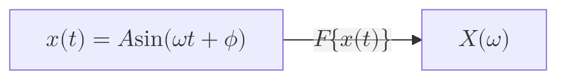

# Theming, Layouts, Frontmatter & CLI Configuration Reference

Authoritative guide to configuring **Mermaid.js (v11.x – v12.2.0)** via YAML frontmatter, selecting layout engines (`elk`, `dagre`, `tidy-tree`, `cose-bilkent`), customizing themes (`redux-color`, `neo`, `handDrawn`, `base` + `themeVariables`), adding accessibility metadata, rendering KaTeX math, and automating exports with `@mermaid-js/mermaid-cli` (`mmdc`).

## Table of Contents
1. [YAML Frontmatter Architecture (v10.5+ – v12.2+)](#1-yaml-frontmatter-architecture-v105--v122)
2. [v12.0+ Per-Diagram Defaults & Config Keys](#2-v120-per-diagram-defaults--config-keys)
3. [Layout Engines (`elk`, `dagre`, `tidy-tree`, `cose-bilkent`)](#3-layout-engines-elk-dagre-tidy-tree-cose-bilkent)
4. [Visual Look Modes (`neo`, `classic`, `handDrawn`)](#4-visual-look-modes-neo-classic-handdrawn)
5. [11 Built-in Themes & Custom `themeVariables` Palettes](#5-11-built-in-themes--custom-themevariables-palettes)
6. [Accessibility (`accTitle` & `accDescr`) & KaTeX Math (`$$...$$`)](#6-accessibility-acctitle--accdescr--katex-math-)
7. [Iconify Icon Packs (`registerIconPacks`)](#7-iconify-icon-packs-registericonpacks)
8. [Headless CLI Rendering (`@mermaid-js/mermaid-cli` / `mmdc`)](#8-headless-cli-rendering-mermaid-jsmermaid-cli--mmdc)

---

## 1. YAML Frontmatter Architecture (v10.5+ – v12.2+)

Always configure per-diagram settings using a **YAML frontmatter block** (`--- ... ---`) at the very top of the diagram code.

> [!IMPORTANT]
> Inline `%%{init: {...}}%%` directives were deprecated in Mermaid v10.5.0 in favor of YAML frontmatter. Only use `%%{init: ...}%%` when targeting legacy parsers that strip leading YAML blocks.

```yaml
---
title: High-Availability Payment Topology
config:
  look: neo
  layout: elk
  theme: redux-color
  flowchart:
    curve: monotoneX
    padding: 16
---
flowchart LR
    A["Ingress"] --> B["Payment Core"]
```

### Configuration Precedence (Highest Wins)
1. **Diagram YAML Frontmatter** (`config.<diagramKey>.<prop>` overrides `config.<prop>`)
2. **Site-level `mermaid.initialize({...})`**
3. **Per-Diagram v12 Default** (see table below)
4. **Global Fallback Default** (`theme: default`, `look: classic`, `layout: dagre`)

---

## 2. v12.0+ Per-Diagram Defaults & Config Keys

Since **Mermaid v12.0.0**, 10 diagram types default to `theme: redux-color` and `look: neo` (and 7 of them default to `layout: elk`). Notice that the **config key** used inside `config:` is often shorter than the diagram declaration keyword:

| Diagram Declaration Keyword | Frontmatter `config:` Key | v12 Default `theme` | v12 Default `look` | v12 Default `layout` |
| :--- | :--- | :--- | :--- | :--- |
| `flowchart` / `graph` | `flowchart` | `redux-color` | `neo` | `elk` |
| `sequenceDiagram` | `sequence` | `redux-color` | `neo` | *(sequence renderer)* |
| `classDiagram` | `class` | `redux-color` | `neo` | `elk` |
| `stateDiagram-v2` | `state` | `redux-color` | `neo` | `elk` |
| `erDiagram` | `er` | `redux-color` | `neo` | `elk` |
| `requirementDiagram` | `requirement` | `redux-color` | `neo` | `elk` |
| `swimlane-beta` | `swimlane` | `redux-color` | `neo` | `swimlane` |
| `usecase-beta` | `usecase` | `redux-color` | `neo` | `elk` |
| `agentflow-beta` | `agentflow` | `redux-color` | `neo` | `elk` |
| `venn-beta` | `venn` | `redux-color` | `neo` | *(venn renderer)* |
| *All other 22 diagram types* | *(e.g., `gantt`, `pie`, `c4`)* | `default` | `classic` | `dagre` *(or native D3)* |

### Restoring the Pre-v12 Classic Appearance
If you need a diagram in Mermaid v12+ to match the traditional v10/v11 appearance and Dagre layout:
```yaml
---
config:
  theme: default
  look: classic
  layout: dagre
---
```

---

## 3. Layout Engines (`elk`, `dagre`, `tidy-tree`, `cose-bilkent`)

| Layout Value | Engine Description | Best Use Cases |
| :--- | :--- | :--- |
| `elk` | **Eclipse Layout Kernel** (bundled in core `mermaid` from v12.0+). Orthogonal routing with superior edge-crossing minimization and nested subgraph handling. | Complex flowcharts ($\ge 10$ nodes), nested subgraphs, ER schemas, class hierarchies, state machines. |
| `elk.mrtree` | ELK Multi-Root Tree algorithm. | Strictly hierarchical org charts and decision trees. |
| `elk.stress` | ELK Stress-minimization algorithm. | Symmetric mesh networks and undirected graphs. |
| `elk.force` | ELK Force-directed physical model. | Clustered topology discovery. |
| `elk.box` / `elk.rectpacking` | ELK Box / Rectangle packing. | Grid-like container packing inside subgraphs or `agentflow-beta`. |
| `dagre` | Classic layered directed graph engine. Fast and compact. | Simple linear flowcharts ($< 10$ nodes) or Tier 2/3 host parity. |
| `tidy-tree` | Non-overlapping hierarchical tree layout. | `mindmap` diagrams where branches otherwise collide. |
| `cose-bilkent` | Compound Spring Embedder layout. | Default radial layout for `mindmap`. |

### ELK Fine-Tuning Options (`config.elk`)
```yaml
---
config:
  layout: elk
  elk:
    mergeEdges: true
    nodePlacementStrategy: BRANDES_KOEPF   # SIMPLE | INTERACTIVE | LINEAR_SEGMENTS | BRANDES_KOEPF | NETWORK_SIMPLEX
    cycleBreakingStrategy: GREEDY          # GREEDY | DEPTH_FIRST | INTERACTIVE | MODEL_ORDER | GREEDY_MODEL_ORDER
---
```

---

## 4. Visual Look Modes (`neo`, `classic`, `handDrawn`)

- **`look: neo`**: Clean, modern geometry with subtle rounded corners and categorical accent borders.
- **`look: classic`**: Traditional Mermaid border and shape styling.
- **`look: handDrawn`**: Rough.js sketch aesthetic ideal for whiteboard RFCs and early-stage design reviews.
  - Set `handDrawnSeed: 42` in `config:` for deterministic SVG output across CI builds (default `0` randomizes strokes on every render).
  - *Note*: `look: handDrawn` is not supported on custom D3 canvas diagrams like `wardley-beta` and `cynefin-beta`.

---

## 5. 11 Built-in Themes & Custom `themeVariables` Palettes

### The 11 Official Built-in Themes
1. `redux-color` *(v12 default for core diagrams — categorical color cycling)*
2. `redux-dark-color` *(dark mode counterpart of `redux-color`)*
3. `redux` *(monochrome modern geometry — best when applying custom semantic `classDef` colors)*
4. `redux-dark` *(monochrome dark mode)*
5. `neo` *(soft modern light theme)*
6. `neo-dark` *(soft modern dark theme)*
7. `default` *(classic Mermaid blue/purple light theme)*
8. `neutral` *(high-contrast grayscale — ideal for black-and-white print/PDFs)*
9. `dark` *(classic dark mode theme)*
10. `forest` *(shades of green)*
11. `base` *(the **only** fully customizable theme for arbitrary `themeVariables`)*

### Custom Brand Theme Blueprint (`theme: base`)
> [!WARNING]
> When customizing `themeVariables`, you **must** set `theme: base` and use **6-digit hex color strings** (`"#1e40af"`). Named CSS colors (`"royalblue"`) are ignored by Mermaid's internal luminance calculator.

```yaml
---
config:
  theme: base
  look: neo
  themeVariables:
    primaryColor: "#eff6ff"
    primaryTextColor: "#1e3a8a"
    primaryBorderColor: "#2563eb"
    secondaryColor: "#f0fdf4"
    secondaryTextColor: "#14532d"
    secondaryBorderColor: "#16a34a"
    tertiaryColor: "#f8fafc"
    tertiaryTextColor: "#0f172a"
    tertiaryBorderColor: "#64748b"
    lineColor: "#475569"
    fontFamily: "Inter, system-ui, -apple-system, sans-serif"
    fontSize: "14px"
---
```

---

## 6. Accessibility (`accTitle` & `accDescr`) & KaTeX Math (`$$...$$`)

### Screen-Reader Accessibility (`accTitle` & `accDescr`)
Supported across diagram types to inject `<title>` (`aria-labelledby`) and `<desc>` (`aria-describedby`) into the root `<svg>`:
- **Single-line**:
  ```text
  accTitle: Short Accessible Title
  accDescr: Concise summary of the diagram's nodes, flows, and key takeaway.
  ```
- **Multi-line description**:
  ```text
  accDescr {
      Detailed multi-line description for assistive technologies.
      Explains the start state, branching logic, and terminal outcomes.
  }
  ```

### Mathematical Typesetting with KaTeX (`$$...$$`, v10.9+)
Supported in `flowchart` and `sequenceDiagram`:


---

## 7. Iconify Icon Packs (`registerIconPacks`)

In browser/ESM or `mmdc` environments, register any icon pack from [icones.js.org](https://icones.js.org/) (`@iconify-json/*`) to use in `flowchart` (`@{ icon: "logos:aws-s3" }`), `architecture-beta` (`service s3(logos:aws-s3)[Bucket]`), `usecase-beta`, and `treeView-beta`:

```javascript
import mermaid from 'mermaid';
mermaid.registerIconPacks([
  {
    name: 'logos',
    loader: () => fetch('https://unpkg.com/@iconify-json/logos@1/icons.json').then((res) => res.json()),
  },
]);
```

---

## 8. Headless CLI Rendering (`@mermaid-js/mermaid-cli` / `mmdc`)

### Essential `mmdc` Commands
```bash
# 1. Render a single .mmd file to crisp SVG with transparent background
npx -p @mermaid-js/mermaid-cli mmdc -i architecture.mmd -o architecture.svg -b transparent

# 2. Render high-DPI Retina PNG (scale 3x) with dark theme
npx -p @mermaid-js/mermaid-cli mmdc -i flow.mmd -o flow.png -t redux-dark-color -b "#0f172a" -s 3

# 3. Extract and compile all ```mermaid blocks inside README.md into ./docs/diagrams/
npx -p @mermaid-js/mermaid-cli mmdc -i README.md -o README.rendered.md -a ./docs/diagrams/

# 4. Fast syntax/render validation via stdin/stdout (no temp files)
cat diagram.mmd | npx -p @mermaid-js/mermaid-cli mmdc -i - -o - -e svg -q > /dev/null
```

### CI / Docker Headless Chromium Sandbox Config
When running `mmdc` inside Docker or Linux CI containers, pass `-p puppeteer-config.json`:
```json
{
  "args": ["--no-sandbox", "--disable-setuid-sandbox", "--disable-dev-shm-usage"]
}
```
